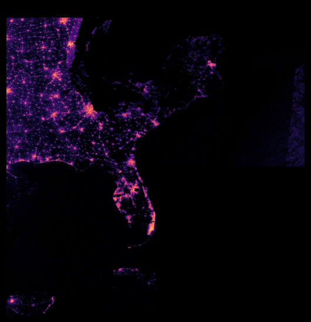

# Blackout from Space

Estimates how many electricity customers lost power in each US county after a hurricane, from NASA's Black Marble night-light images, and grades those estimates against the US Department of Energy's EAGLE-I outage counts on storms the model never saw.

This is a personal project, built out of curiosity about what night-light images can say about power outages. County numbers come with ranges and are hatched out where the satellite can't see. As a worked example, the app joins the county estimates to a synthetic list of insured properties: how many of those policies are expected to be without power, and for how long, and whether a claim's outage length fits what happened in that county. The policies and claims are made up.



## Quickstart on the bundled sample (offline)

```bash
uv sync
uv run pytest
uv run blackout export --sample
cd app && npm ci && npm run dev
```

The sample is three real Florida counties (Lee, Charlotte, Collier) through Hurricane Ian. It needs no downloads or account.

## Full run

1. Make a free [NASA Earthdata](https://urs.earthdata.nasa.gov) account and generate a token. Put it in a gitignored `.env` file in the repo root, as `EARTHDATA_TOKEN=...`, or export it in your shell. The pipeline stops with a clear message if it is missing.
2. Fetch the public inputs: EAGLE-I's yearly outage files, HURDAT2 and the Census county files.

   ```bash
   uv run python -I scripts/fetch_eaglei.py 2018 2020 2021 2022 2023 2024
   uv run python -I -c "from blackout.counties import ensure_census_files; ensure_census_files()"
   curl -o data/raw/hurdat2/hurdat2-1851-2025-02272026.txt --create-dirs \
     https://www.nhc.noaa.gov/data/hurdat/hurdat2-1851-2025-02272026.txt
   ```
3. Build and score:

   ```bash
   uv run blackout build --all     # about 3 hours; satellite tiles stream into memory and are never saved
   uv run blackout evaluate        # leave-one-storm-out scorecard -> docs/scorecard.md
   ```

   On a fresh build `blackout evaluate` rewrites `docs/scorecard.md` in your copy as a draft, without the lockbox section, and `uv run blackout export --storm milton2024` stops with an error. Both wait for `data/processed/lockbox_result.json`. Only `uv run blackout lockbox` writes that file, and this project ran it once (decision log, D-12); its result is kept in `docs/lockbox_result.json`. A run in your own copy would be a new result, not that record: `docs/scorecard.md` in your copy would then show your numbers, and the test that guards the record (LB-45) would fail because the two files differ.

## Reproduce it on free compute

You do not need the author's data to check the numbers. `scripts/reproduce.py` rebuilds part of Hurricane Ian from NASA and EAGLE-I and compares it with what the repository committed; it runs on a laptop, on a GitHub Actions runner (free for a public repository), or in a free Google Colab session. Levels 1 and 2 need a free NASA Earthdata token ([urs.earthdata.nasa.gov](https://urs.earthdata.nasa.gov); tokens expire 60 days after they are generated, and the script tries the token on one byte of a real tile before it downloads anything large).

| Level | What it checks | Time (estimates) | Download |
|---|---|---|---|
| 0 | The test suite, the sample export and the frozen lockbox record (offline) | 2-3 min | none |
| 1 | Lee, Charlotte and Collier counties rebuilt for all 55 Ian nights, every column against `data/sample/` | 15-25 min on Colab's 2 vCPUs | about 5.5 GB |
| 2 | All of Ian (505 counties, 3 tiles) against the fingerprint in `docs/reproduce/` | 35-60 min on Colab; the build alone took 8 min on an 8-core laptop | about 14 GB |

```bash
uv run python -I scripts/reproduce.py --level 1 --report reproduce-report.json
```

- **Colab:** open [notebooks/reproduce_colab.ipynb](notebooks/reproduce_colab.ipynb) in Google Colab, add your Earthdata token as the secret `EARTHDATA_TOKEN`, and run the four cells. Satellite tiles stream through memory, so the free CPU runtime's 12 GB is enough. Keep the tab open: free Colab ends the session on disconnect and caches nothing between sessions.
- **GitHub Actions:** the `reproduce` workflow runs on demand (Actions → reproduce → Run workflow, pick the level) with the token stored as the repository secret `EARTHDATA_TOKEN`. GitHub offers Run workflow only to accounts with write access, so to run it yourself, fork the repository, enable Actions in the fork if GitHub asks, and add your own token there under the same secret name. Without the secret a level 1 or 2 run stops with an error that says so (a fork drops to level 0 with a warning). The report is uploaded as an artifact and summarised on the run page. Each level was timed once on a runner, on 2026-11-10 in the development repository (see Project notes), from start to finish: level 1 about 3 minutes, level 2 about 4.5 minutes.
- **Only if you keep a private copy:** Colab cannot download a private repository without a login, so add a read-only GitHub token as the Colab secret `GITHUB_TOKEN` and set `REPO` in the notebook's cell 1 to your copy. GitHub Actions runs in a private repository are metered against the plan's included usage.

A pass means the pipeline, run from scratch elsewhere, gives the same county-night numbers that fed the recorded lockbox run, within floating-point tolerance: at level 1 every column of the three counties' 165 rows, at level 2 the counts and sums of every measured column for each night and for each county, the number of values present in each (so a missing value is not mistaken for a zero), plus Lee County's whole series. The level-2 fingerprint is a summary, not the table: it would miss a rearrangement that keeps all of those sums and counts. A run counts as a pass only if it reached its end: the report of one that was killed or interrupted says `"complete": false` and `"passed": false`, and the notebook shows it as INCOMPLETE.

The EAGLE-I, Census and HURDAT2 downloads are pinned in `docs/reproduce/inputs.json` (figshare MD5s and the EAGLE-I row count, Census and HURDAT2 SHA-256s), so a change in one of them is reported by its own check. NASA's satellite tiles are not pinned: each download is checked only against the MD5 NASA lists for it that day, so a reprocessing by NASA shows up as different numbers, just as a code change would. A failed tile download is another matter: it gets its own check, fails the run, and the comparison is skipped rather than run on half the data. The lockbox result itself is frozen in `docs/lockbox_result.json` and is never recomputed.

## How it works

1. **Measure.** For each county and night, keep only clear, good-quality pixels of `DNB_BRDF-Corrected_NTL`, never the gap-filled layer. Compare them with the same pixels' median over clear nights in the month before landfall. The result is "% darker", plus how much of the county's normal light was visible. Counties that are mostly hidden are "can't see", and very dark rural counties are "not measurable". Neither is ever shown as zero.
2. **Answer key.** EAGLE-I's county count at the moment the satellite passed (from VNP46A1's `UTC_Time`), taken as the median of the 15-minute runs within ±60 minutes. Runs where the scraper lost a utility's feed are dropped first; see `flag_dropouts` and the decision log.
3. **Translate.** One monotone curve (isotonic regression) maps "% darker", corrected for viewing angle and moonlight, to "% of customers out". It is learned on past storms only.
4. **Grade.** Each main storm is held out in turn, and the curve is compared against a wind-only guess and "nothing happened". Helene and Milton (2024) stayed locked until the pass bar was committed.

## Scorecard

**The pre-registered test failed.** The night-light curve beat a wind-only guess on county error on both locked storms (Helene, Milton) but did not reach the agreement or restoration-day conditions written down before the lockbox opened. A second model with storm context finds the heavy outages the curve misses, but about 90% of its skill comes from wind band and timing, not from the satellite; the satellite's confirmed contribution is about two points of error on heavily hit county-nights.

| Leave-one-storm-out, eight main storms, ±60 | Curve (pre-registered) | Hybrid | Wind + timing | Wind only | Nothing |
|---|---|---|---|---|---|
| County error, all scored nights (pp) | 2.42 | 2.95 | 2.84 | 2.63 | 2.17 |
| Error where official ≥ 10% out (pp) | 38.8 | 24.1 | 25.7 | 36.5 | 39.8 |
| AUC for "at least half out" | 0.75 | 0.96 | 0.93 | 0.82 | 0.50 |

Full tables, the lockbox verdict and the NOAA-20 cross-check: [docs/scorecard.md](docs/scorecard.md). Where it goes wrong, with real cases: [docs/failures.md](docs/failures.md). The reasoning: [docs/writeup.md](docs/writeup.md).

## Limits

- **County level only.** EAGLE-I can't check anything finer, so nothing finer is claimed.
- **Clouds.** After a hurricane, many nights are cloudy. Those county-nights get no estimate, and restoration days come back as intervals.
- **EAGLE-I has its own errors:** feed dropouts longer than 3 hours, and over-counts above a county's customer total. Both are listed on the failure page.
- **Snow** (Winter Storm Uri) brightens the ground, so Uri is scored separately as a stress test.
- **Suomi NPP** stopped sending data in November 2026. NOAA-20 (`VJ146A2`) is checked against it on three storms.

## Licence and data sources

The code and documentation in this repository are released under the MIT licence: see [LICENSE](LICENSE). That licence and its copyright line cover the project's own work only. The data the pipeline downloads keep their sources' terms, and so do the excerpts and derived values kept in `tests/fixtures/`, `data/sample/`, `app/public/data/` and `docs/`; no claim is made over any of it.

- **Night lights:** NASA Black Marble VNP46A1/VNP46A2 (Suomi NPP) and VJ146A1/VJ146A2 (NOAA-20), Collection 2, from LAADS DAAC and Earthdata Cloud; DOIs [10.5067/VIIRS/VNP46A1.002](https://doi.org/10.5067/VIIRS/VNP46A1.002), [VNP46A2.002](https://doi.org/10.5067/VIIRS/VNP46A2.002), [VJ146A1.002](https://doi.org/10.5067/VIIRS/VJ146A1.002) and [VJ146A2.002](https://doi.org/10.5067/VIIRS/VJ146A2.002). NASA's catalogue lists all four as free and open data under its [data use guidance](https://www.earthdata.nasa.gov/engage/open-data-services-software-policies/data-use-guidance): CC0 for data from NASA-led missions unless marked otherwise, with a request to cite the data and acknowledge NASA as the source. The night-light pictures in `docs/img/` are drawn by this project from these products.
- **Outages:** EAGLE-I county outage records, 2014–2025 (Oak Ridge National Laboratory), version 4 on figshare, [doi:10.6084/m9.figshare.24237376](https://doi.org/10.6084/m9.figshare.24237376), licensed [CC BY 4.0](https://creativecommons.org/licenses/by/4.0/); described in Brelsford, C. et al., "A dataset of recorded electricity outages by United States county 2014–2022", *Scientific Data* 11, 271 (2024), [doi:10.1038/s41597-024-03095-5](https://doi.org/10.1038/s41597-024-03095-5). None of the original files is kept here, only changed forms: short excerpts in `tests/fixtures/`, and values worked out from the data in `data/sample/`, `app/public/data/` and `docs/`.
- **Storm tracks:** NOAA National Hurricane Center HURDAT2 (Landsea and Franklin 2013, *Mon. Wea. Rev.* 141, 3576–3592). NHC's [disclaimer](https://www.nhc.noaa.gov/disclaimer.shtml) says information on government servers is in the public domain unless annotated otherwise. `tests/fixtures/hurdat2_small.txt` is an excerpt, not the official file.
- **Counties and housing:** U.S. Census Bureau cartographic boundary files (counties, 1:500,000, 2021 and 2022), whose metadata says they are free to use provided the U.S. Census Bureau is acknowledged as the source; and American Community Survey 5-year table B25001 (2021 and 2022), for which see the source's terms, starting with the Census Bureau's [citation guidance](https://www.census.gov/about/policies/citation.html): it asks that the Bureau be cited as the source of the original data.
- **Fonts in the web app:** IBM Plex Sans and IBM Plex Mono, under the SIL Open Font License 1.1, installed from npm through `@fontsource`. No font files are kept in this repository.

None of these organisations endorses this project or is affiliated with it.

## Prior art

- [NASA SPoRT](https://ntrs.nasa.gov/citations/20170011710) checked a satellite outage product against EAGLE-I for Hurricane Matthew.
- [Xu et al. 2023](https://doaj.org/article/0f63bb3628de43969fae48bb8937c2c6) mapped Winter Storm Uri outages from Black Marble.
- [GeoOutageKG](https://arxiv.org/pdf/2507.22878) (2025) pairs Black Marble with EAGLE-I for Ian and Milton.
- [NASA Earth Observatory](https://earthobservatory.nasa.gov/images/150431/power-outages-after-hurricane-ian) published outage images after Ian.

## Project notes

A personal project using public data only. The design is in [docs/design.md](docs/design.md), the plan in [docs/plan.md](docs/plan.md), and every judgment call in [docs/decision-log.md](docs/decision-log.md).

**History.** The public repository starts from a single commit. The project was developed in a private repository (the development repository), which is kept as an archive. The commit hashes cited in these documents (for example `2f534f9`, the pass bar) are commits of that archive, so they cannot be looked up in the public repository. That the pass bar came first and the lockbox after therefore rests on the author's record: the public repository cannot prove it on its own. The first public commit's message names the archive's final commit, and the two commits hold the same files. Three checks read the archive's history: that the pass bar was committed before any lockbox score; that the model files did not change between the model choice and the lockbox run's commit (LB-21); and that the recorded run's code matches the commit it names, which comes after the pass bar and the model choice (LB-41). All three passed against the history during development (for LB-41, see the S1a block of [docs/scorecard.md](docs/scorecard.md)) and are skipped, each with its reason, where the history is absent. The decision-log entry of 2026-11-11 says what can still be checked without it.
