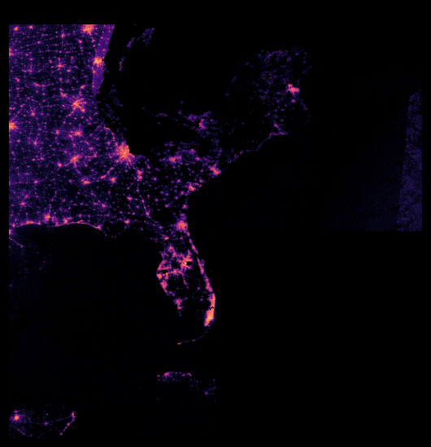

# Where it fails

Real cases from the eight main storms, Uri and the NOAA-20 cross-check. Each one is a county-night from the built tables, with the night labelled as the local night (file date minus one day). The lockbox storms are added at the end, after the pass bar was scored.

Numbers in this page: "% darker" is tonight's clear-pixel light against the county's own baseline over the same pixels. "Corrected" means after the viewing-angle and moonlight correction fit on calm nights. "Official" is EAGLE-I's ±60-minute median at the pass, with feed-dropout runs removed, divided by the county's customer count.

## 1. Clouds hide the week that matters

After a hurricane the sky is rarely clear. Across the eight main storms, hit counties could be measured on 55% of their event nights. The first week is worse:

| Storm | Hit-county nights measurable, first week | Can't see |
|---|---|---|
| Beryl 2024 (NOAA-20) | 11% | 89% |
| Laura 2020 | 46% | 42% |
| Ian 2022 | 50% | 48% |
| Isaias 2020 | 51% | 37% |
| Florence 2018 | 54% | 37% |
| Michael 2018 | 60% | 24% |
| Ida 2021 | 61% | 38% |
| Idalia 2023 | 79% | 20% |

Beryl is the hard case. The landfall night was clear (97% of hit counties), then nights 1–6 after landfall were 3–44% measurable, and the sky opened only on night 7. The model's picture of Beryl's restoration is therefore an interval, "between night 0 and night 7", for most of the Houston area. This is why every restoration figure in the app is a range and why "can't see" is hatched, never coloured as 0%.

## 2. Rural counties: not enough light to lose

A county needs some light to go dark. With the cutoff used here (a baseline total of 2,000 radiance units over the county, roughly 4,000 pixels at the sensor's noise floor), Florence has 92 counties marked not measurable (41 in Virginia, 35 in Georgia, 16 in North Carolina), and 10 of them were inside the storm's wind zone: Camden, Chowan, Gates, Hyde, Jones and Pamlico counties in North Carolina, among others. They were certainly without power; the satellite cannot say how much. Their median baseline total is 1,429, under the cutoff.

Per storm: Florence 92 of 438 counties, Laura 76 of 475, Isaias 57 of 532, Uri 53 of 254, Michael 42 of 439, Beryl 34 of 318, Ian 32 of 505, Idalia 9 of 372, Ida 6 of 213.

## 3. Viewing angle: the same county reads 50 points brighter from the side

The satellite sees a county from a different angle each night, and on the calm nights before landfall that angle explains most of the night-to-night noise. Fit on 61,942 calm county-nights of the main storms, the slope is −0.50 per unit of (sec θ − 1): a county viewed 60° from vertical reads about 50 points brighter than from overhead, before any outage. Moonlight adds 0.0055 per unit of lunar irradiance.

The correction fixes much of it, but not all. Of the 201 scored county-nights where EAGLE-I had at least half the customers out, 79 read less than 15% darker before correction and 52 still do after it. Eighteen read more than 20% *brighter* than their baseline while mostly without power:

| County | Night | Official out | Raw % darker | Corrected | View angle |
|---|---|---|---|---|---|
| Jefferson, TX (Laura) | 2020-08-28 | 91% | −45% | +16% | 63° |
| St. John the Baptist, LA (Ida) | 2021-09-01 | 88% | −59% | −8% | 61° |
| Wakulla, FL (Michael) | 2018-10-12 | 52% | −75% | −23% | 61° |
| Galveston, TX (Beryl) | 2024-07-08 | 90% | −26% | +6% | 52° |

Jefferson and St. John the Baptist are refinery parishes (Port Arthur, Garyville). Flaring after an emergency shutdown is a plausible extra reason they read bright, but this page can only report the numbers; it cannot see the flares. A county's own calm-night spread is also wide: Jefferson's corrected darkening has a standard deviation of 0.18 on calm nights, St. John the Baptist's 0.24, so a single night's reading of either is uncertain by that much before any storm.

## 4. Snow: Uri reads brighter, not darker

Winter Storm Uri (Texas, February 2021) is scored separately because snow brightens the ground. Even with snow-flagged pixels allowed, counties read a median 83% *brighter* than their snow-free January baseline on the event nights, and 80% of measurable county-nights read more than 20% brighter. The method as built cannot estimate Uri's outages; a snow-aware baseline would be needed. Its scorecard row is reported with that caveat, and the EAGLE-I dropout constants were tuned partly on Uri, so its official numbers are not a clean test either.

## 5. The answer key has its own errors

EAGLE-I is a scrape of utility outage maps every 15 minutes. Two kinds of error survive the dropout rule (decision log, 2026-11-08):

- **Feed dropouts longer than 3 hours.** DEMCO's feed in Louisiana dropped for 38 runs on 2021-08-30 and 117 runs from 08-31 to 09-01, and both stretches cover a satellite pass. Livingston Parish's official count at the pass of the night of 08-31 reads 20,678 (37% out); the next night, with the feed back, it reads 49,132 (88%). The rule only removes dips that recover within 3 hours, so these stay in the answer key and count as model error.
- **Over-counts.** A county's reported outages can exceed its customer count. After the customer-count repair, Michael has 28 county-nights above 105% (Clay County, GA, 241%; Franklin County, FL, 231%), Laura 38, Ida 36, Uri 36 (Austin County, TX, 744%), Beryl 14 (San Jacinto, TX, 334%), Idalia 7, Florence 3 and Ian 2 (Highlands, FL, 130%). Values above 105% are dropped from fitting and scoring and values between 100% and 105% are clipped, so these county-nights are missing from the scorecard rather than wrong in it.

## 6. The customer counts needed repair

EAGLE-I's customers-per-county file covers only 34% of North Carolina's customers against EAGLE-I's own state total, so Wilmington's Florence outage read 44 times its customer count. North Carolina's counts are replaced by Census housing units scaled to the state total, and 26 counties elsewhere (19 in Texas, 6 in Virginia, Norton city) that were outside 1/3–3 customers per housing unit are replaced the same way. The source of each count is kept in the table (`customers_source`). Any remaining error in the denominators lands in the official % out, not in the satellite reading.

## 7. Two satellites do not agree county by county on calm nights

On the same counties and nights, Suomi NPP and NOAA-20 give the same answer for Lee County after Ian (darkest night September 29, 75% and 76%; half-recovery two nights before EAGLE-I's on both), but across all counties their uncorrected "% darker" agree weakly: Spearman 0.08 on Ian's 972 shared county-nights (0.29 on storm nights), 0.37 on Ida's 5,739 (0.12 on storm nights), 0.63 on Beryl's 7,588 (0.71 on storm nights). The two satellites pass about 50 minutes apart at different angles, so most of the disagreement is the viewing-angle effect of section 3, which is largest where nothing happened. Real outages agree better than calm nights do.

## 8. Lockbox storms: Helene and Milton, scored once

Scored on 2026-11-08 after the pass bar and the model choice were committed. The full tables are in `docs/scorecard.md`.

- **The pre-registered curve fails the bar on both storms.** It beats the wind-only guess on county error (Helene 6.8 vs 7.0 points, Milton 1.3 vs 1.8), but its night-to-night agreement with EAGLE-I is 0.09 on both storms against the required 0.3, and its median restore-day error is 4 days on Helene and 3 on Milton against the allowed 2. As on the main storms, it never estimates more than about 10% out, so on Helene it misses all 52 counties that were above half out at 72 hours.
- **The hybrid does not pass the bar either.** It gets more of the night-to-night movement (0.18) but still well under 0.3, its restore-day error is 5 days, and on these two storms it does not beat wind-only on county error (7.2 vs 7.0; 2.2 vs 1.8).
- **The satellite's registered test against wind + timing came out "yes", narrowly.** On county-nights at least 10% out, the hybrid's error is 2.1 points lower than its no-satellite twin on Helene (33.0 vs 35.1) and 2.0 lower on Milton (12.9 vs 15.0). The AUC condition on Helene passed by 0.0006, which is no difference; Milton had only 4 half-out county-nights, so its AUC condition could not be judged. Read it as: the satellite reading nudges the estimate in the right direction on heavily hit counties, by about two points, and does not improve the ranking of which counties were worst hit.
- **Helene is the hard storm.** 566 scored county-nights were at least 10% out across the southern Appalachians, where the hybrid's error on those nights is 33 points. A parametric trigger at "above 50% out at 72 hours" built on the hybrid would have paid 17 counties, 5 of them correctly, and missed 47 of the 52 counties that qualified. On the curve it would have paid none. That is the basis-risk number this project set out to measure, and it is bad.
- **Milton was mild in EAGLE-I's eyes at the pass times:** 41 county-nights at least 10% out and 4 at least half out, so most of Milton's counties were scored on calm-looking nights, which is where the curve's low error comes from.
- **Ranges held up about as designed:** on held-out main-storm rows the 80% ranges covered 85% (curve) and 81% (hybrid) of official values over all rows, and 78% and 71% on hit counties after landfall.
