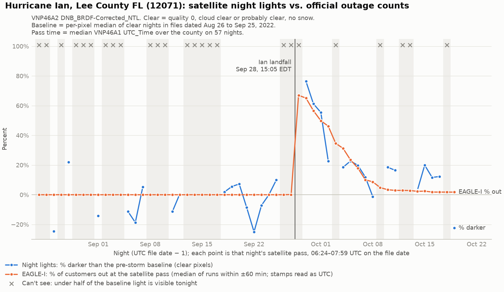

# Phase 0: Hurricane Ian in Lee County, FL

**Result (2026-11-07): PASS under the rule logged before any data was seen. It is a marginal pass, not a robust one.**

- **Peaks:** the satellite and the official counts peak on the same night.
- **Recovery:** each falls to half its peak within 2 nights of the other, which is exactly the limit.
- **Verification:** independent agents rebuilt every number from the raw files and matched to the last digit, and 69 adversarial tests could not overturn the verdict.
- **Fragility:** the recovery check sits on its limit, a narrower outage-data window flips it to FAIL, and the rank correlation mostly reflects that both series decay.

Claude wrote these notes and the `scripts/phase0/` code at the user's request (see `docs/decision-log.md`). The detailed agent reports are in `docs/phase0/`. The files they name under `data/raw/` and `data/interim/` are local downloads and outputs: both folders are gitignored, so they are not in the repository.

## 1. The verdict

| Criterion (logged in advance) | Result |
|---|---|
| Peak timing (within 1 night) | Both peak on the **night of Sep 29**: 76.3% darker vs 65.1% of customers out. 0 nights apart ✓ |
| Recovery timing (within 2 nights) | Half its peak on **Oct 2** (satellite) vs **Oct 4** (EAGLE-I). 2 nights apart, exactly at the limit ✓ |
| Same direction (Spearman ≥ 0.6, at least 5 nights) | 0.771 over 15 clear nights after landfall ✓ |
| Noise check | Normal pre-storm nights average −5.2% with an sd of 12.9%. The peak sits about 6 sd above that. |

Inputs to the verdict:
- 57 VNP46A2 files and 57 VNP46A1 files, every MD5 verified.
- 32 nights where the county was visible and 25 too cloudy to see. The night of landfall (Sep 28) was only 18% visible.
- Scoring script: `scripts/phase0/verdict.py`. Output: `data/interim/phase0_verdict.json`.

### Why it is marginal (from the verification workflow)

- **Recovery is on its limit.** EAGLE-I on Oct 4 is 0.480 of its peak. With 8,167 more customers out that night, the gap becomes 3 nights and the verdict FAILs. Any recovery fraction below 0.485 fails too.
- **The outage window matters.** Reading EAGLE-I over ±30 minutes, instead of the logged ±60, gives FAIL. The cause is a second, unrecorded feed dropout at 07:00–07:15 UTC on 2022-09-30: Lee fell to 240,270 against about 411,600 in the runs on either side. It sits inside the peak night's window. With ±90 minutes the verdict passes again.
- **Spearman mostly measures the shared decay.**
  - EAGLE-I against time alone scores 0.996.
  - After removing each series' decay, the correlation is −0.06; first differences give 0.38.
  - The decision log reasoned that rank correlation avoids the shared-trend problem. That was wrong, and the note there now says so.
- **Pass rate at this noise level.** A model-based bootstrap passes about 35% of the time, or 59–65% after correcting for viewing angle. The rule discriminates weakly between storms.

## 2. The four checks

1. **The gap-filled layer hides the blackout.**
   - On the first file after landfall (Sep 29), it reads **43% darker at "100% visibility"**. The truly clear pixels read **78% darker**.
   - What fills the gaps is a mix:
     - 3,917 no-retrieval pixels (33% of the light) carry pre-landfall values from earlier nights;
     - about 1,000 flag-1 pixels carry old values;
     - about 2,000 hold that night's poor-quality radiance.
   - On clear nights the layer barely differs: 76.3% vs 74.7% on Sep 30.
2. **Quality code 1 must stay excluded.**
   - On the cloudy landfall night, 25% of Lee pixels are code 1.
   - Keeping them makes that night "visible" at 89.7% darker. But code-1 radiances swing between −161% and +94% darker across nights, so they are not trustworthy.
3. **EAGLE-I's clock is UTC.**
   - What decides it: runs exist inside the hour that daylight-saving time skips (2021 and 2022), and Texas's Uri blackouts start at 07:25 UTC, matching ERCOT's order.
   - Lee's surge timing fits UTC, but it does not decide the clock on its own. Read as New York time, 10% out lands 10 minutes after landfall, not "4 hours late" as an earlier note said.
4. **Night convention.**
   - The first clear dark file is **Sep 30** (night Sep 29), the same date NASA's Black Marble team used for its Ian image.
   - The Sep 28 and Sep 29 files were too cloudy for the strict version of the check, so check 4 reads "inconclusive". But the pass times confirm the convention:
     - the Sep 28 pass came 12.7 hours **before** landfall, with 0.16% out;
     - the Sep 29 pass came 12.7 hours **after** landfall, with 67% out.

## 3. How it was verified (ultracode workflow, 7 agents, 69 tests)

- **Independent recomputation.** Two agents rebuilt every value from the raw HDF5 files without opening the project code. They matched the night table, the 12,015-pixel county mask, the baseline total, the pass times and the EAGLE-I values **to the last float64 digit**.
- **Geolocation.** The mask is not shifted or transposed:
  - the land/water flags under Lee read 80% land, while the Gulf to the west reads 100% sea;
  - the best whole-pixel shift is (0, 0);
  - the brightest pixels sit on Fort Myers, Cape Coral and the RSW airport.
- **Artifacts.**
  - In Collection 2, every quality-0 pixel over Lee is "confident clear" with no cirrus, so the cloud-mask choices never bind.
  - Viewing angle explains most of the baseline "noise" (Spearman −0.87).
  - The corrected layer over-subtracts moonlight: moonlit nights read 6–11% darker.
- **Timing.**
  - Pass times are on the file date, confirmed by file metadata and by Moon geometry (within 0.28° on the file date, about 13° off a day either side).
  - They imply Suomi NPP's 01:25 descending node.
- **Robustness.** These variants still PASS:
  - the visible-share threshold from 0.05 to 0.95;
  - quality code 1 included;
  - both alternative baselines;
  - the EAGLE-I window at ±90 minutes;
  - angle and moon corrections.

  The variants that FAIL are ±30 or ±15 minutes, from the dropout, and a lunar correction about 1.8× steeper than fitted.

## 4. Findings worth keeping

- **Pixel coordinates.** VNP46A1 and VNP46A2 lat/lon arrays mark the **top-left pixel edges**: lat[0] = 30.0, lon[0] = −90.0. The guide doesn't say this; the files' grid metadata does.
- **Pass times.** Over Lee they run **06:25–07:59 UTC** (median 07:09), about 01:00–02:30 local solar time. The plan's original "01:30 on the clock" (05:30 UTC) was wrong.
- **The peak is real:** 5.9 leave-one-out sd above the baseline.
- **The mid-October gap on the chart is mostly artifact.** Lee looks 10–20% darker while EAGLE-I shows 2–3% out. After angle and moon corrections it shrinks to 3–4%. The exception is the **barrier islands**: 2.6% of Lee's light, 33–83% darker on late nights. That is real lasting darkness and a sub-county signal worth building on.
- **EAGLE-I has many feed dropouts in Ian's window.** The 2026-11-08 decision-log entry lists them, including some the dropout rule can't catch. Phase 0 found these two, and the rule catches both:
  - Sep 29, 09:15–10:45 UTC: Florida's total halved.
  - Sep 30, 07:00–07:15 UTC: Lee fell to 58% of the neighbouring runs.

  Separately, 107 Florida runs have no Lee row.

## 5. Inputs checked before the run

- **EAGLE-I (2022, plus a 2021 cross-check):** 25.8M rows; runs every 15 minutes, with 3 missing in all of 2022.
  - Explicit 0 rows and absent counties both mean 0.
  - `MCC.csv` has a byte-order mark, Windows line endings, unpadded codes and a trailing `Grand Total` row. Lee has 628,635 customers.
  - Florida coverage is 97–98% for 2018–2022.
- **Black Marble facts:** two independent readers plus a reconciler. See `docs/phase0/blackmarble-facts.json`.
- **Counties and storm:**
  - ACS housing units: Lee 419,916 (1.5 customers per housing unit).
  - Ian's landfall: Cayo Costa, 2022-09-28 19:05 UTC.
  - Hurricane-force winds over Lee, Charlotte, Sarasota and Manatee.
- **NASA's own Ian imagery:** read in the browser through WebBridge. It used Sep 30 against an August composite, about 2.7M Florida customers were out on Sep 29, and about 580k by Oct 3.

## 6. What this changes for Week 2 onward

These changes are recorded in `docs/plan.md` and `docs/decision-log.md`.

1. **Dropout handling.** EAGLE-I dropout handling must catch partial dips, like the 58% dip above, not just near-zero ones. Both Ian dropouts become regression tests, and every result gets reported at ±30, ±60 and ±90 minutes.
2. **Angle and moon.** Correct for viewing angle (a sec(zenith) term, or same-orbit baselines 16 days apart) and for moonlight before fitting the translation curve. Report leave-one-out noise as well as in-sample noise.
3. **A better rule before the lockbox.** Before opening the Helene and Milton lockbox, log a better agreement rule: a detrended or first-difference statistic, dropout masking and a recovery margin. Ian must not be re-scored under a changed rule and called a new pass.
4. **NOAA-20 cross-check.** Run `VJ146A2` on Ian to see whether the peak and the 2-night recovery gap hold on an independent sensor.
